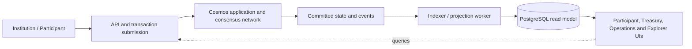

# Architecture Proposal — Institutional Settlement Network

Status: **Proposed; not approved for implementation.**

This document captures the initial direction for discussion. It is not a claim that the architecture is complete or production suitable.

## Goals

- Learn how a Cosmos-based application can model institutional settlement.
- Make correctness and accounting invariants explicit and testable.
- Explore how off-chain query/read models can support user-facing interfaces without becoming the source of truth.
- Practice failure testing, reconciliation, observability, security review, and operational design.

## Provisional logical view

The diagram is conceptual. It does not yet specify transaction transport, authentication, key custody, module boundaries, event delivery guarantees, topology, or a finalized stack.

## Provisional system boundaries

1. **Settlement application:** proposed authoritative state machine for accepted settlement transactions.
2. **Submission/API layer:** transaction construction/submission and user-facing contracts; exact trust boundary remains to be designed.
3. **Indexer and read model:** derived projection from authoritative chain data; designed for replay and rebuild.
4. **Reconciliation:** compares independently derived views and handles mismatches explicitly; it must not silently rewrite authoritative settlement state.
5. **Web consoles:** potential participant/bank portal, treasury console, network operations console, and blockchain explorer.

## Domain invariants to define before coding

The following are questions and design requirements, not finalized rules:

- What asset and amount representation is valid? Which precision and denomination rules apply?
- What exactly constitutes an accepted, settled, rejected, expired, or reversed transaction?
- Which participant may debit or credit which account, under what authorization?
- How are duplicate submissions identified and made safe?
- Which transitions are legal, and can any transition occur more than once?
- How are aggregate debits, credits, supply, holds, fees, and reversals conserved?
- Which state and event fields are public, sensitive, or prohibited from on-chain storage?
- What evidence is required to reconcile the indexer with committed chain state?

No implementation should begin until the initial invariant set and state-transition model have been reviewed.

## Consistency and read-model posture

- Chain state is intended to be authoritative for settlement.
- PostgreSQL is a query-optimized projection and must be rebuildable from an agreed source of truth.
- The design must account for delayed, duplicated, missing, or out-of-order event processing as applicable.
- Reconciliation reports mismatches and follows an explicit repair policy; it does not quietly treat the read model as authoritative.
- Query APIs must communicate the freshness and provenance of projected data where that matters.

## Cross-chain / IBC scope

IBC is a candidate later stage, not a prerequisite for the first local prototype. Before implementation, pin compatible releases and explicitly model packet send, acknowledgement, timeout, refund, retry, and reconciliation paths. Validate the exact semantics against the selected IBC-Go release and test environment.

## Candidate technology choices (unlocked)

- Cosmos SDK and CometBFT versions: pending compatibility verification
- IBC-Go: optional later stage, pending compatibility verification
- CosmWasm: optional; do not add unless a concrete requirement and compatibility review justify it
- PostgreSQL for derived read models
- Go standard library `net/http` for an auxiliary API if an API service is needed; do not default to Gin
- React and TypeScript for web interfaces, if included in the approved scope
- Local development on Windows 11 + WSL2 Ubuntu; verify all tools are Linux-native in the WSL development context

## Risks requiring design work

- Double-spend or unauthorized state transitions
- Incorrect accounting/rounding or non-conserving state changes
- Duplicate/replayed requests and unclear idempotency
- Divergence between committed state and indexer projection
- Event gaps, reordering, and replay behavior
- Key compromise and inappropriate trust in API/indexer layers
- Unclear governance, upgrades, incident response, or participant onboarding
- Incompatibility between selected SDK, CometBFT, IBC-Go, and optional Wasm releases

## Approval gates

1. Compatibility report with exact official release/module evidence
2. Domain model, legal state transitions, and invariant test plan
3. Threat model and explicit trust boundaries
4. Transaction and indexer/reconciliation flow review
5. Written approval before implementation begins

## Related learning repository

Concepts and labs must be documented in `hari-devloper/cosmos-learning-lab` and referenced by stable concept IDs. Keep source code and build dependencies independent across the two repositories.
